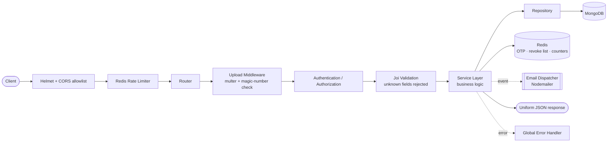
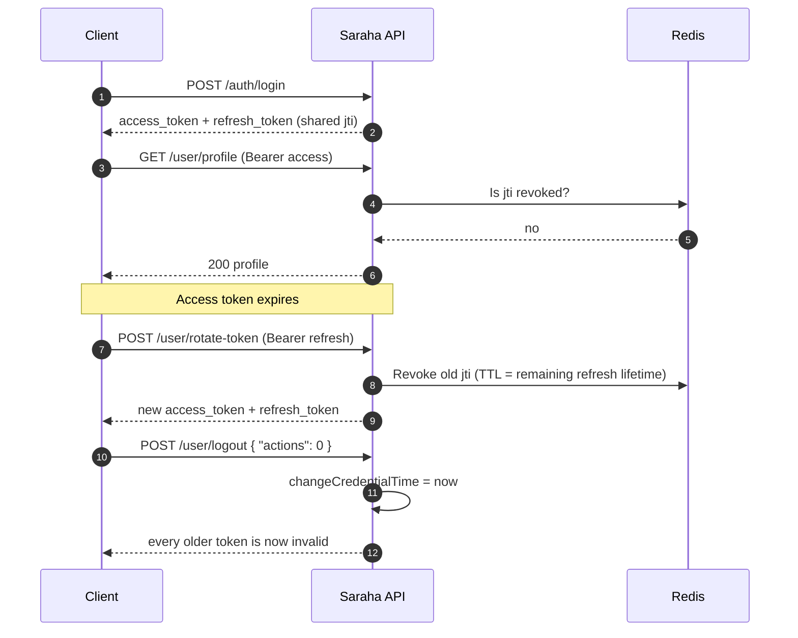
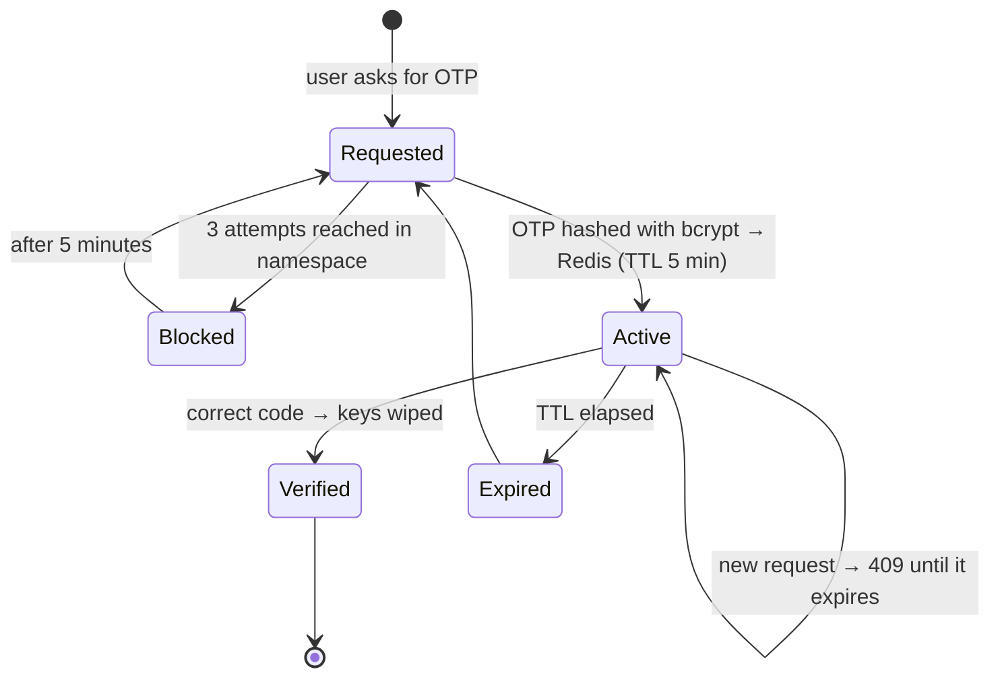
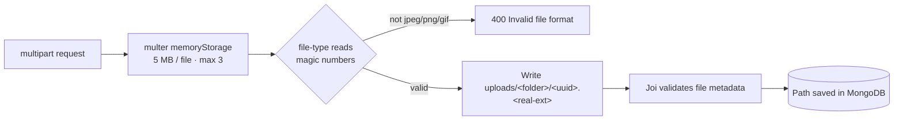

<div align="center">

                ```text
                ███████╗ █████╗ ██████╗  █████╗ ██╗  ██╗ █████╗      █████╗ ██████╗ ██╗
                ██╔════╝██╔══██╗██╔══██╗██╔══██╗██║  ██║██╔══██╗    ██╔══██╗██╔══██╗██║
                ███████╗███████║██████╔╝███████║███████║███████║    ███████║██████╔╝██║
                ╚════██║██╔══██║██╔══██╗██╔══██║██╔══██║██╔══██║    ██╔══██║██╔═══╝ ██║
                ███████║██║  ██║██║  ██║██║  ██║██║  ██║██║  ██║    ██║  ██║██║     ██║
                ╚══════╝╚═╝  ╚═╝╚═╝  ╚═╝╚═╝  ╚═╝╚═╝  ╚═╝╚═╝  ╚═╝    ╚═╝  ╚═╝╚═╝     ╚═╝
                ```

### 🕊️ Say it honestly. Stay anonymous. Stay secure.

**A security-first REST API for anonymous messaging and honest feedback.**

<br/>

[](#-license)
[](https://nodejs.org/)
[](https://expressjs.com/)
[](https://www.mongodb.com/)
[](https://redis.io/)

[](#-authentication--session-security)
[](#-strict-payload-validation)
[](#-redis-backed-rate-limiting--otp-throttling)
[](#-security-checklist)
[](#-security-checklist)
[](#-authentication--session-security)
[](#-roadmap)
[](#-contributing)

<br/>

**Designed & engineered by [✨ Eslam 3laa ✨](#-author)**

[About](#-about-the-project) · [Features](#-key-features--engineering-highlights) · [Architecture](#-architecture--tech-stack) · [Quick Start](#-getting-started) · [API](#-api-reference) · [Security](#-security-checklist)

</div>

---

## 📑 Table of Contents

- [About the Project](#-about-the-project)
- [Key Features & Engineering Highlights](#-key-features--engineering-highlights)
- [Architecture & Tech Stack](#-architecture--tech-stack)
- [Project Directory Structure](#-project-directory-structure)
- [Getting Started](#-getting-started)
- [Environment Variables](#-environment-variables)
- [API Reference](#-api-reference)
- [Deep Dives](#-deep-dives)
- [Security Checklist](#-security-checklist)
- [Roadmap](#-roadmap)
- [Contributing](#-contributing)
- [License](#-license)
- [Author](#-author)

---

## 💡 About the Project

**Saraha** (صراحة, *"honesty"*) is a backend platform that lets people send and receive **anonymous, constructive feedback and messages** while keeping the sender's identity private and the data layer trustworthy.

Anyone can drop a message (with optional image attachments) into a user's inbox using only that user's public ID. Registered users can also send messages *with* their account when they want attribution, and every owner gets a private inbox they can search, paginate and clean up.

> **Core philosophy:** treat every request as hostile until proven otherwise.

| Principle | How Saraha delivers it |
| --- | --- |
| 🔐 **Security-first architecture** | Helmet headers, CORS allowlist, bcrypt hashing, AES-256 field encryption, hashed OTPs, JWT revocation. |
| 🧱 **Robust input validation** | Every route is guarded by a Joi schema that **rejects unknown fields** (`.unknown(false)`). |
| 🔑 **Secure authentication flows** | Email OTP verification, Google OAuth, optional email 2FA, refresh-token rotation, global logout. |
| 🧩 **Structured modular design** | Feature modules (`auth`, `user`, `message`) on top of shared security, repository and utility layers. |

---

## 🚀 Key Features & Engineering Highlights

### 🔐 Authentication & Session Security
- **Stateless JWT** with separate **access** and **refresh** secrets and unique `jti` per login.
- **Token rotation:** `POST /user/rotate-token` issues a fresh pair from a valid refresh token and **revokes the old one** in Redis.
- **Two logout modes:** revoke only the current session, or **log out everywhere** by bumping `changeCredentialTime` so every previously issued token is rejected.
- **Password hashing** with `bcrypt` (configurable salt rounds).
- **Google Sign-In** using server-side ID-token verification (`google-auth-library`) and a verified-email check.
- **Optional email-based 2FA** for login, enabled and disabled through an OTP-confirmed flow.
- **Role-based authorization** (`USER` / `ADMIN`) through a reusable middleware.

### 🛡️ Redis-Backed Rate Limiting & OTP Throttling
- **Global limiter:** 1,000 requests / 15 min per *client subnet + method + route*, counted atomically in Redis (IPv6 addresses are normalised with `ipKeyGenerator`).
- **OTP namespaces** (`ConfirmEmail`, `ForgotPassword`, `TwoFactorAuthentication`, `TwoFactorAuthentication_login`) each carry their own state, so abuse of one flow never affects another.
- **Brute-force protection:** a new OTP cannot be requested while the previous one is alive, and after **3 attempts** the namespace is locked for **5 minutes**.
- OTPs are generated with `crypto.randomInt`, **stored only as bcrypt hashes**, and expire after **5 minutes**.

### ✅ Strict Payload Validation
- **Joi schemas** for `body`, `query`, `params` and uploaded `files`.
- `.unknown(false)` intercepts and rejects every unmapped field, which blocks mass-assignment and payload-smuggling attempts.
- `abortEarly: false` returns **all** violations at once in a consistent shape: `{ message, path, key }`.
- Reusable `generalRules` (email, password, phone, ObjectId, DOB, etc.) keep rules identical across modules.

### 📎 Multi-File Upload Security
- `multer` **memory storage** with a **5 MB** per-file cap and a hard limit of **3 attachments** per message.
- **Binary magic-number verification** with [`file-type`](https://github.com/sindresorhus/file-type): the real MIME type is read from the raw bytes, **not** from the client-supplied header or extension.
- Nothing touches the disk until the buffer passes validation; files are then saved under a **random UUID** filename with the *detected* extension.
- Whitelist: `image/jpeg`, `image/png`, `image/gif`.

### 🗄️ Data Integrity & Privacy
- **Mongoose schemas** with typed fields, enums, length constraints, unique indexes and `strict` mode.
- **AES-256-CBC field-level encryption** (random IV per value) for sensitive data such as phone numbers.
- Generic **repository layer** (`create`, `find`, `findOne`, `findById`, …) with built-in pagination, search and populate.
- Anonymous messages store **no sender reference**; identified messages store `senderId`.

### 📬 Automated Email Dispatch
- **Nodemailer** SMTP dispatcher driven by an **event emitter**, so HTTP requests never wait on mail delivery.
- Branded HTML templates for account verification, password reset and 2FA codes.

---

## 🏗️ Architecture & Tech Stack

| Layer | Technology |
| --- | --- |
| **Runtime** | Node.js ≥ 20 (native **ES Modules**) |
| **Framework** | Express 5 |
| **Database** | MongoDB with Mongoose 9 (users, messages) |
| **Caching & Throttling** | Redis 6 client: OTP store, rate limiting, token revocation list |
| **Security** | JWT (`jsonwebtoken`), `bcrypt`, `helmet`, `cors`, Node `crypto` (AES-256-CBC) |
| **Validation** | Joi 18 |
| **Uploads** | Multer 2 + `file-type` |
| **Email** | Nodemailer |
| **Social Login** | Google OAuth 2.0 (`google-auth-library`) |
| **Pattern** | Modular, layered architecture: Router/Controller → Service → Repository → Model |

### Request Lifecycle



### Token Lifecycle



---

## 📂 Project Directory Structure

```text
saraha-app/
├── config/
│   ├── config.service.js          # Loads & exports env config per NODE_ENV
│   ├── .env.development           # (git-ignored) local secrets
│   └── .env.production            # (git-ignored) production secrets
├── src/
│   ├── main.js                    # Application entry point & middleware pipeline
│   ├── DB/
│   │   ├── connection.db.js       # MongoDB connection
│   │   ├── redis.connection.js    # Redis client & connector
│   │   └── model/
│   │       ├── user.model.js      # User schema (roles, provider, 2FA, virtual userName)
│   │       └── message.model.js   # Message schema (content, attachments, sender/receiver)
│   ├── modules/                   # Feature modules (controller · service · validation)
│   │   ├── auth/                  # Signup, login, OTP, Google, 2FA, password reset
│   │   ├── user/                  # Profile, token rotation, logout, profile photo
│   │   └── message/               # Send (anonymous / identified), list, read, delete
│   ├── middleware/
│   │   ├── authentication.middleware.js   # JWT verification + revocation checks
│   │   ├── authorization.middleware.js    # Role-based access control
│   │   ├── validation.middleware.js       # Joi runner for body / query / params / files
│   │   ├── multer.middleware.js           # Upload pipeline wrapper
│   │   └── error.middleware.js            # Global error handler
│   └── common/
│       ├── enum/                  # Roles, providers, token types, logout types, 2FA
│       ├── exception/             # Typed HTTP exceptions (400/401/403/404/409/429)
│       ├── repository/            # Generic data-access helpers
│       ├── security/              # bcrypt, JWT, AES-256 encryption helpers
│       ├── services/              # Redis cache service (get/set/ttl/incr/…)
│       ├── events/                # Email event emitter
│       └── utils/
│           ├── email/             # Nodemailer transport, HTML templates, OTP helpers
│           ├── multer/            # Upload config + magic-number validation
│           ├── response/          # Uniform success response
│           ├── limiter.js         # Redis-backed rate limiter
│           ├── corsOptions.js     # Origin allowlist
│           └── generalRules.js    # Shared Joi rules
├── .env.example                   # Environment variables template
├── .gitignore
├── package.json
└── README.md
```

---

## ⚡ Getting Started

### Prerequisites

| Requirement | Version |
| --- | --- |
| Node.js | **20 or newer** |
| MongoDB | Local instance or [Atlas](https://www.mongodb.com/atlas) cluster |
| Redis | Local instance or any managed Redis |
| Gmail account | With an [App Password](https://support.google.com/accounts/answer/185833) for SMTP |
| Google Cloud OAuth client | *Optional*, only for Google Sign-In |

### Installation

```bash
# 1. Clone the repository and enter it
git clone https://github.com/Eslam-Alaa-ElDeen/saraha-app.git
cd saraha-app

# 2. Install dependencies
npm install

# 3. Create your environment file from the template
cp .env.example config/.env.development

# 4. Fill in your values (see the table below), then start the server
npm run start:dev
```

You should see:

```text
DB connect successfully 💯
redis connection stablish successfully
Sara7a app listening on port 7000!
```

### NPM Scripts

| Script | Command | Purpose |
| --- | --- | --- |
| `npm run start:dev` | `nodemon` + `NODE_ENV=development` | Hot-reload development |
| `npm start` | `node` + `NODE_ENV=development` | Run once with development config |
| `npm run start:prod` | `node` + `NODE_ENV=production` | Production run (`config/.env.production`) |

### Quick Smoke Test

```bash
curl http://localhost:7000/
# {"message":"Welcome to Eslam 3laa server"}
```

---

## 🔧 Environment Variables

Config files live in `config/` and are picked by `NODE_ENV` (`.env.development` / `.env.production`). **Never commit them**: they are already in `.gitignore`.

| Variable | Description | Example |
| --- | --- | --- |
| `PORT` | HTTP port (defaults to `7000`) | `7000` |
| `DB_URI` | MongoDB connection string | `mongodb://127.0.0.1:27017/saraha` |
| `SALT` | bcrypt cost factor | `10` |
| `ENCRYPTION_KEY` | **Exactly 32 characters** (AES-256 key) | `change-me-to-a-32-character-key!` |
| `IVLENGTH` | AES IV length in bytes (must be `16`) | `16` |
| `ACCESS_TOKEN_SIGNATURE` | Secret that signs access tokens | long random string |
| `ACCESS_TOKEN_EXPIRES_IN` | Access token lifetime **in seconds** | `3600` |
| `REFRESH_TOKEN_SIGNATURE` | Secret that signs refresh tokens (use a different one) | long random string |
| `REFRESH_TOKEN_EXPIRES_IN` | Refresh token lifetime **in seconds** | `31536000` |
| `WEB_CLIENT_ID` | Google OAuth web client ID | `xxxx.apps.googleusercontent.com` |
| `REDIS_URI` | Redis connection URL | `redis://127.0.0.1:6379` |
| `APP_EMAIL` | Sender Gmail address | `you@gmail.com` |
| `APP_PASSWORD` | Gmail **App Password** | `abcd efgh ijkl mnop` |
| `PROJECT_NAME` | Display name used in emails | `Saraha` |
| `ALLOWED_ORIGINS` | Comma-separated CORS allowlist | `http://localhost:3000,https://app.example.com` |

> 💡 Generate strong secrets with: `node -e "console.log(require('crypto').randomBytes(48).toString('hex'))"`

---

## 📡 API Reference

**Base URL:** `http://localhost:7000`  ·  **Auth header:** `Authorization: Bearer <token>`

### Response Envelope

```jsonc
// ✅ Success
{ "status": 201, "message": "message sent successfully", "data": { /* … */ } }

// ❌ Validation failure (400)
{
  "message": "Validation failed. Please correct the highlighted fields.",
  "arrError": [
    { "message": "Unsupported field \"role\" in request body.", "path": "role", "key": "body" }
  ]
}
```

### 🔑 Auth: `/auth`

| Method | Endpoint | Auth | Description |
| --- | --- | :---: | --- |
| `POST` | `/auth/signup` | – | Register and receive an email OTP |
| `PATCH` | `/auth/confirm_otp` | – | Confirm email with the 6-digit OTP |
| `POST` | `/auth/resend_otp` | – | Request a new confirmation OTP |
| `POST` | `/auth/login` | – | Login. Returns tokens, or sends an OTP when 2FA is on |
| `POST` | `/auth/login-confirm-email-two-factor-authentication` | – | Finish a 2FA login with the OTP |
| `POST` | `/auth/signup-with-gmail` | – | Sign up / log in with a Google ID token |
| `POST` | `/auth/forget_password_send_otp` | – | Send a password-reset OTP |
| `PATCH` | `/auth/update_password` | – | Reset the password with OTP + new password |
| `POST` | `/auth/send-otp-two-factor` | ✅ Access | Start enabling / disabling 2FA |
| `PATCH` | `/auth/confirm-otp-two-factor` | ✅ Access | Confirm the 2FA change with the OTP |

### 👤 User: `/user`

| Method | Endpoint | Auth | Description |
| --- | --- | :---: | --- |
| `GET` | `/user/profile` | ✅ Access (`USER`/`ADMIN`) | Get the current user's profile |
| `POST` | `/user/rotate-token` | ✅ **Refresh** | Exchange a refresh token for a new pair |
| `POST` | `/user/logout` | ✅ Access | `actions: 1` current session · `actions: 0` all sessions |
| `POST` | `/user/profile_photo` | ✅ Access | Upload a profile photo (`multipart`, field `attachment`) |

### 💌 Messages: `/message`

| Method | Endpoint | Auth | Description |
| --- | --- | :---: | --- |
| `POST` | `/message` | – | **Send an anonymous message** (`content`, `receiverId`, up to 3 `attachments`) |
| `POST` | `/message/by-account` | ✅ Access | Send a message with your identity attached |
| `GET` | `/message` | ✅ Access | List messages, paginated. Query: `type` (`0` received · `1` sent · `2` both), `page`, `limit` (≤ 100), `search`, `populate` |
| `GET` | `/message/:messageId` | ✅ Access | Fetch a single message |
| `DELETE` | `/message/:messageId` | ✅ Access | Delete a message |

### Example Requests

<details>
<summary><b>📝 Sign up</b></summary>

```bash
curl -X POST http://localhost:7000/auth/signup \
  -H "Content-Type: application/json" \
  -d '{
    "userName": "Eslam Alaa",
    "email": "eslam@example.com",
    "password": "StrongPass#2026",
    "phone": "01012345678",
    "gender": 0,
    "DOB": "1999-05-20"
  }'
```
</details>

<details>
<summary><b>🔐 Log in &amp; call a protected route</b></summary>

```bash
# Login
curl -X POST http://localhost:7000/auth/login \
  -H "Content-Type: application/json" \
  -d '{ "email": "eslam@example.com", "password": "StrongPass#2026" }'

# Use the access token
curl http://localhost:7000/user/profile \
  -H "Authorization: Bearer <access_token>"
```
</details>

<details>
<summary><b>🕊️ Send an anonymous message with attachments</b></summary>

```bash
curl -X POST http://localhost:7000/message \
  -F "receiverId=<target-user-id>" \
  -F "content=Your presentation was fantastic!" \
  -F "attachments=@./photo1.png" \
  -F "attachments=@./photo2.jpg"
```
</details>

<details>
<summary><b>🔄 Rotate tokens</b></summary>

```bash
curl -X POST http://localhost:7000/user/rotate-token \
  -H "Authorization: Bearer <refresh_token>"
```
</details>

<details>
<summary><b>🚪 Log out of every device</b></summary>

```bash
curl -X POST http://localhost:7000/user/logout \
  -H "Authorization: Bearer <access_token>" \
  -H "Content-Type: application/json" \
  -d '{ "actions": 0 }'
```
</details>

### HTTP Status Codes

| Code | Meaning |
| :---: | --- |
| `200` / `201` | Success / created |
| `400` | Validation failure, bad OTP, or rejected file |
| `401` | Missing, invalid, expired or revoked token |
| `403` | Role not allowed |
| `404` | Resource or account not found, or unknown route |
| `409` | Conflict (duplicate email, OTP still active, rotation too early) |
| `429` | Rate limit or OTP attempt limit reached |

---

## 🔬 Deep Dives

### OTP Lifecycle



### Upload Pipeline



### Key Design Decisions

- **Modules own their routes, services and schemas.** Adding a feature means adding a folder, not editing five.
- **Services throw typed exceptions** (`NotFoundException`, `ConflictException`, …); one global handler maps them to HTTP status codes.
- **Redis as the source of truth for ephemeral state:** OTPs, attempt counters, rate-limit buckets and the token revocation list all expire on their own.
- **Fire-and-forget email** via an event emitter keeps endpoint latency independent of SMTP speed.

---

## ✅ Security Checklist

| Area | Control |
| --- | --- |
| Transport headers | `helmet` |
| Cross-origin | CORS **allowlist** from `ALLOWED_ORIGINS` |
| Passwords | `bcrypt` with configurable cost |
| Sensitive fields | AES-256-CBC with a random IV per value |
| OTPs | CSPRNG generation, hashed at rest, 5-minute TTL, attempt lockout |
| Tokens | Separate access/refresh secrets, `jti`, Redis revocation, global invalidation |
| Input | Joi with `.unknown(false)` on body, query and params |
| Uploads | Memory buffering, size caps, magic-number MIME verification, random filenames |
| Abuse | Redis-backed rate limiting + per-flow OTP throttling |
| Proxies | `trust proxy` enabled for correct client IPs behind a load balancer |
| Secrets | Environment files git-ignored |

> 🔒 **Deploying to production?** Use HTTPS, rotate every secret in `.env.production`, restrict `ALLOWED_ORIGINS`, and run Redis and MongoDB on private networks.


---

## 🤝 Contributing

Contributions are welcome!

1. **Fork** the project
2. Create a branch: `git checkout -b feature/amazing-feature`
3. Commit your changes: `git commit -m "feat: add amazing feature"`
4. Push: `git push origin feature/amazing-feature`
5. Open a **Pull Request**

Please follow the existing module layout (`controller` → `service` → `validation`) and keep every new input covered by a strict Joi schema.

---

## 📄 License

Distributed under the **MIT License**.

```text
MIT License · Copyright (c) 2026 Eslam 3laa
```

---

## 👨‍💻 Author

<div align="center">

### ✨ **Eslam 3laa** ✨
*Backend Engineer · Node.js · API Security*

Built with care, caffeine, and a healthy distrust of user input. 🛡️

⭐ **If Saraha helped or inspired you, please give it a star!** ⭐

</div>
